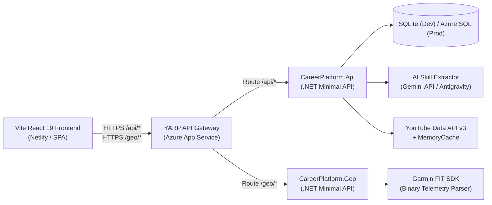

# Career & Skill Architecture Platform

A high-performance, multi-service web application serving as an interactive professional portfolio, learning tracker, and geospatial data visualizer for **John Bendfeldt**.

Target production domain: **[johnbendfeldt.com](https://johnbendfeldt.com)**

## System Architecture



## Key Architectural Highlights

### 1. Multi-Scheme Authentication & One-Click Guest Demo
- Direct recruiter bypass endpoint (`POST /api/auth/guest`) that mints signed JWTs with `role: "guest"` and `guest_mode: "true"`.
- ASP.NET Core authorization policies (`RequireWriteAccess`) enforce read-only demo privileges for guest recruiters.
- Pre-seeded database state: completely bypasses the empty state with technical initiatives, personal goals, and outbound verified links.

### 2. Verified Production Deployments Showcase
- **Training Hour Tracker (`trainingtracker.advsol.com`)**: Enterprise staff development and hour tracking application on corporate Advanced Solutions International (ASI) domain, verified by DOM author metadata (`<meta name="author" content="John Bendfeldt" />`) and DevTools console signature.
- **Basic Language School (`basiclanguage.school`)**: Live public language learning PWA supporting 210 bidirectional language pairs across 15 languages with interactive active-recall quizzes and custom virtual keyboards (Cyrillic, Arabic, Indic).
- **country-province-data (npm)**: Open-source international address data package with **hundreds of weekly downloads** (thousands of times a year), zero open bugs, and 8 years in continuous production use.

### 3. AI Skill Extraction & Dynamic Learning Catalogs
- Asynchronously processes candidate resumes, job specs, or engineering goals via `IAiSkillExtractor`.
- Employs strict JSON schema extraction with structured string array output.
- Queries the **YouTube Data API v3** dynamically with in-memory 24-hour caching (`IMemoryCache`) to recommend top-tier tutorials and courses.

### 4. Geospatial Garmin FIT Microservice
- Dedicated C# Minimal API utilizing the official **Garmin FIT SDK (`Garmin.FIT.Sdk`)**.
- Decodes high-frequency binary `.fit` telemetry files (Garmin Forerunner 255 Music), converting 32-bit semicircle coordinates to latitude/longitude degrees.
- Computes elevation profiles and renders vector polyline layers with interactive coordinate popups.
- Client-side `.gpx` generator and exporter.

---

## Security Hardening

- **Content Security Policy & Edge Headers**: Strict CSP (`script-src 'self' https://accounts.google.com`, `object-src 'none'`, `base-uri 'self'`, `frame-ancestors 'none'`, `form-action 'self'`, `upgrade-insecure-requests`), `HSTS` (`max-age=63072000; includeSubDomains; preload`), `Cross-Origin-Opener-Policy: same-origin-allow-popups`, `X-XSS-Protection: 0`, `Permissions-Policy`, and anti-stale `Cache-Control` headers across Netlify (`netlify.toml`), Nginx (`web/nginx.conf`), and all .NET 10 services.
- **URL & Browser Storage Validation**: Outbound links and avatars are validated via `isSafeHttpsUrl`, `isSafeImageUrl`, and `sanitizeExternalUrl`; `localStorage` JSON parsing strips prototype-pollution keys (`__proto__`, `constructor`, `prototype`) and enforces structural type guards.
- **OAuth & Row-Level Security (RLS)**: Google OIDC implicit hash flows require a verified cryptographic `rawNonce` in `sessionStorage`; Supabase PostgreSQL tables (`infra/supabase-schema.sql`) enforce least-privilege grants (`REVOKE ALL ... FROM anon`), column length `CHECK` constraints, and `auth.uid() = user_id` write policies.
- **Telemetry Privacy & DoS Protection**: Preloaded routes enforce a 400-meter residential privacy geofence; `.FIT` uploads validate binary header magic (`.FIT`), file size bounds, and in-memory coordinate caps; Gemini API keys are sent via `x-goog-api-key` headers behind origin-restricted CORS.

See [`SECURITY.md`](SECURITY.md) for the complete security architecture and vulnerability reporting policy.

---

## Quick Start (Local Development)

### Prerequisites
- .NET 10.0 SDK (`10.0.x`)
- Node.js 22 LTS+ & npm
- Docker (optional for containerized orchestration)

### Option A: Run via .NET & Vite CLI

1. **Start the Microservices**:
   ```bash
   # Terminal 1: Core API (Port 5100)
   dotnet run --project src/Api --urls http://127.0.0.1:5100

   # Terminal 2: Geospatial FIT Service (Port 5200)
   dotnet run --project src/Geo --urls http://127.0.0.1:5200

   # Terminal 3: YARP Reverse Proxy Gateway (Port 5050)
   dotnet run --project src/Gateway --urls http://127.0.0.1:5050
   ```

2. **Start the Frontend**:
   ```bash
   # Terminal 4: React 19 + Vite 8 SPA (Port 5173)
   cd web
   npm install
   npm run dev
   ```

3. **Open the App**:
   Navigate to `http://localhost:5173` and click **"Sign In / Build Your Own"** or explore the portfolio directly!

---

### Option B: Run via Docker Compose

```bash
docker compose up --build
```
- Gateway: `http://localhost:5000` (proxies to non-root `.NET 10` containers on port `8080`)
- API: `http://localhost:5100`
- Geo: `http://localhost:5200`
- Web: `http://localhost:3000`

---

## Automated Test Suite

Execute both the backend xUnit integration suite and frontend Vitest + ESLint checks:
```bash
# Backend xUnit integration tests (WebApplicationFactory)
dotnet test CareerPlatform.sln

# Frontend ESLint, Vitest unit tests, and production bundle verification
npm --prefix web run lint
npm --prefix web test
npm --prefix web run build
```

---

## Production Deployment

- **Frontend**: Configured for Netlify with [`netlify.toml`](netlify.toml) and [`web/netlify.toml`](web/netlify.toml).
- **Database**: Supabase PostgreSQL schema & RLS policies in [`infra/supabase-schema.sql`](infra/supabase-schema.sql).
- **Backend Services**: Non-root multi-stage Dockerfiles in `src/Api/Dockerfile`, `src/Gateway/Dockerfile`, and `src/Geo/Dockerfile`.
- **CI/CD Pipeline**: Azure DevOps [`azure-pipelines.yml`](azure-pipelines.yml).
