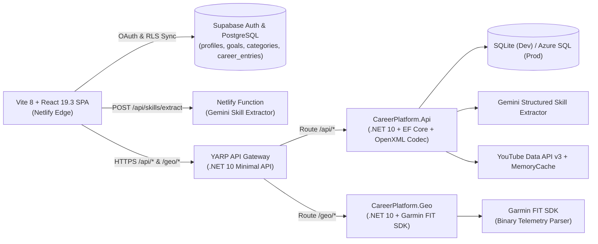

# Career & Skill Architecture Platform

A high-performance, multi-service web application serving as an interactive professional portfolio, career advancement & study-hour tracker, AI skill pipeline, and geospatial telemetry visualizer for **John Bendfeldt**.

Production domain: **[johnbendfeldt.com](https://johnbendfeldt.com)**

## System Architecture



## Key Architectural Highlights

### 1. Multi-Mode Workspace Architecture & Read-Only Portfolio Preview
- **Read-Only Portfolio Preview vs. Personal Workspaces**: Visitors and one-click Guest Recruiters (`POST /api/auth/guest`) explore John's seeded portfolio in a clear **Read-Only Portfolio Preview** (`ReadOnlyPortfolioBanner` + ASP.NET Core `RequireWriteAccess` policy), while GitHub, Google (OIDC nonce-verified), and Microsoft OAuth users unlock isolated **Personal Workspaces** (`auth.uid() = user_id`), custom vanity URLs (`/profile/:slug`), and one-click **Portfolio <-> Personal** switching.
- **Pre-Seeded Relational Data**: Launches with live technical initiatives, career development entries, categories, and verified outbound links so reviewers see full metrics immediately without an empty state.

### 2. Tandem Strategic Goals & Career Advancement Activity Tracker
- **Tandem Goal Rollup**: Relational study-hour entries (`career_entries` + `categories`) link directly to Strategic Goals (`goalId` / `targetHours`), automatically summing logged hours and recalculating goal completion percentages across both the frontend and .NET API.
- **Annual Pace & Quarterly Checkpoints**: Interactive `AnnualProgressBanner` visualizes yearly development hour targets, Q1–Q4 cumulative milestones, ahead/behind pace indicators, category filters, and year selectors.
- **Zero-Dependency OpenXML `.xlsx` & `.csv` Import/Export**: Browser-native ZIP/`DecompressionStream` OpenXML codec (`web/src/utils/xlsxCodec.ts`) paired with C# `AdvancementSpreadsheetService`, supporting bulk spreadsheet upload (validation preview, fuzzy category/goal matching, duplicate detection) and styled OpenXML `.xlsx` exports (`Career Development` worksheet with annual summary header and zebra-striped entries table) or OWASP-safe `.csv` downloads.

### 3. AI Skill Extraction & Curriculum-to-Goal Bridge
- **Structured Extraction (`IAiSkillExtractor` & Netlify Function)**: Extracts normalized technical skills from candidate resumes, job descriptions, or engineering goals using Gemini structured JSON schema output with deterministic client keyword fallback.
- **One-Click Study Pipeline (`aiCurriculumBridge.ts`)**: Converts extracted skills and curated YouTube/Udemy learning pathways directly into tracked `Learning` goals (`targetHours`) or pre-populated Career Advancement study sessions.

### 4. Verified Production Deployments & Printable Executive Resume
- **Training Hour Tracker (`trainingtracker.advsol.com`)**: Enterprise staff development and hour tracking application on corporate Advanced Solutions International (ASI) domain, verified by DOM author metadata (`<meta name="author" content="John Bendfeldt" />`) and DevTools console signature.
- **Basic Language School (`basiclanguage.school`)**: Live public language learning PWA supporting 210 bidirectional language pairs across 15 languages with interactive active-recall quizzes and custom virtual keyboards (Cyrillic, Arabic, Indic).
- **country-province-data (npm)**: Open-source international address data package with **hundreds of weekly downloads** (thousands of times a year), zero open bugs, and 8 years in continuous production use.
- **Career Timeline & Print/PDF Resume**: Interactive engineering timeline with CSP-safe printable executive resume export (`resumePdfExport.ts`).

### 5. Geospatial Garmin FIT Microservice
- Dedicated C# Minimal API utilizing the official **Garmin FIT SDK (`Garmin.FIT.Sdk`)**.
- Decodes high-frequency binary `.fit` telemetry files (Garmin Forerunner 255 Music), converting 32-bit semicircle coordinates to latitude/longitude degrees.
- Computes elevation profiles and renders Leaflet polyline layers with interactive coordinate popups and client-side `.gpx` export.

---

## Security Hardening

- **Content Security Policy & Edge Headers**: Strict CSP (`script-src 'self'`, `worker-src 'self'`, `object-src 'none'`, `base-uri 'self'`, `frame-ancestors 'none'`, `form-action 'self'`, `upgrade-insecure-requests`), `HSTS` (`max-age=31536000; includeSubDomains; preload`), `Cross-Origin-Opener-Policy: same-origin-allow-popups`, `X-XSS-Protection: 0`, `Permissions-Policy`, and anti-stale `Cache-Control` headers across Netlify (`netlify.toml`, `web/netlify.toml`), Nginx (`web/nginx.conf`), and all .NET 10 services.
- **URL, Browser Storage & Spreadsheet Validation**: Outbound links and avatars are validated via `isSafeHttpsUrl`, `isSafeImageUrl`, and `sanitizeExternalUrl`; `localStorage` JSON parsing strips prototype-pollution keys (`__proto__`, `constructor`, `prototype`) and enforces structural type guards; `.xlsx` imports bound file size (`2 MB`) and streaming unzip size (`10 MB` abort cap); and `.csv` exports neutralize OWASP formula-injection prefixes.
- **OAuth, API Authorization & Row-Level Security (RLS)**: Google OIDC implicit hash flows require a verified cryptographic `rawNonce` in `sessionStorage`; `CareerPlatform.Api` enforces `RequireWriteAccess` on all mutating endpoints; and Supabase PostgreSQL tables (`profiles`, `goals`, `categories`, `career_entries`, `user_roles`) in [`infra/supabase-schema.sql`](infra/supabase-schema.sql) enforce least-privilege grants (`REVOKE ALL ... FROM anon, authenticated`), column length `CHECK` constraints, and `auth.uid() = user_id` ownership policies.
- **Telemetry Privacy & DoS Protection**: Preloaded static routes enforce a 400-meter residential privacy geofence; `.FIT` uploads validate binary header magic (`.FIT`), file size bounds, and in-memory coordinate caps; Gemini API keys are sent via `x-goog-api-key` headers behind origin-restricted CORS.

See [`SECURITY.md`](SECURITY.md) for the complete security architecture and vulnerability reporting policy.

---

## Quick Start (Local Development)

### Prerequisites
- .NET 10.0 SDK (`10.0.x`)
- Node.js 22 LTS+ & npm
- Docker (optional for containerized orchestration)

### Option A: Run via .NET & Vite CLI

1. **Start the Microservices**:
   ```bash
   # Terminal 1: Core API (Port 5100)
   dotnet run --project src/Api --urls http://127.0.0.1:5100

   # Terminal 2: Geospatial FIT Service (Port 5200)
   dotnet run --project src/Geo --urls http://127.0.0.1:5200

   # Terminal 3: YARP Reverse Proxy Gateway (Port 5050)
   dotnet run --project src/Gateway --urls http://127.0.0.1:5050
   ```

2. **Start the Frontend**:
   ```bash
   # Terminal 4: React 19.3 + Vite 8 SPA (Port 5173)
   cd web
   npm install
   npm run dev
   ```

3. **Open the App**:
   Navigate to `http://localhost:5173` and explore the portfolio in preview mode or click **"Sign In / Build Your Own"** to launch your personal workspace!

---

### Option B: Run via Docker Compose

```bash
docker compose up --build
```
- Gateway: `http://localhost:5000` (proxies to non-root `.NET 10` containers on port `8080`)
- API: `http://localhost:5100`
- Geo: `http://localhost:5200`
- Web: `http://localhost:3000`

---

## Automated Test Suite & Deploy Gates

Every production build (`npm --prefix web run build` via `prebuild`, multi-stage `Dockerfile` builds for `Api`, `Geo`, and `Gateway`, and CI) automatically enforces linting and tests before deployment:

```bash
# Full deploy-gate verification (Oxlint + 72 Vitest/Serverless/Config/Privacy tests + tsc & Vite build + 27 .NET 10 xUnit tests)
npm run verify

# Or run individual suites:
dotnet test CareerPlatform.sln -c Release   # Api.Tests (21), Geo.Tests (4), Gateway.Tests (2)
npm --prefix web run lint                   # Oxlint
npm --prefix web test                       # Vitest across 10 suites (API, advancement, xlsx/csv codec, AI bridge, modals, GPX/PDF, Netlify Function, CSP/RLS/FIT privacy)
npm --prefix web run build                  # Automatically runs prebuild (lint + test) before tsc -b & vite build
```

---

## Production Deployment

- **Frontend**: Configured for Netlify with [`netlify.toml`](netlify.toml) and [`web/netlify.toml`](web/netlify.toml).
- **Database**: Supabase PostgreSQL schema & RLS policies in [`infra/supabase-schema.sql`](infra/supabase-schema.sql).
- **Backend Services**: Non-root multi-stage Dockerfiles in `src/Api/Dockerfile`, `src/Gateway/Dockerfile`, and `src/Geo/Dockerfile`.
- **CI/CD Pipelines**: GitHub Actions ([`.github/workflows/ci.yml`](.github/workflows/ci.yml)) and Azure DevOps ([`azure-pipelines.yml`](azure-pipelines.yml)).
