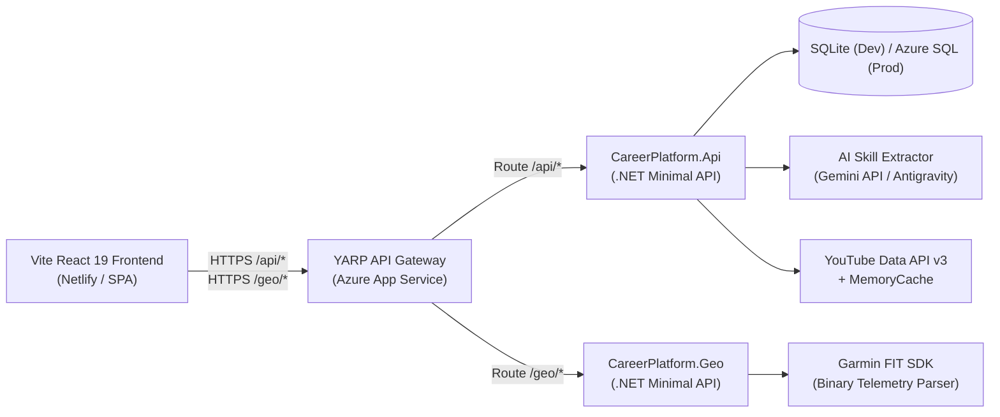

# Career & Skill Architecture Platform

A high-performance, multi-service web application serving as an interactive professional portfolio, learning tracker, and geospatial data visualizer for **John Bendfeldt**.

Target production domain: **[johnbendfeldt.com](https://johnbendfeldt.com)**

## System Architecture



## Key Architectural Highlights

### 1. Multi-Scheme Authentication & One-Click Guest Demo
- Direct recruiter bypass endpoint (`POST /api/auth/guest`) that mints signed JWTs with `role: "guest"` and `guest_mode: "true"`.
- ASP.NET Core authorization policies (`RequireWriteAccess`) enforce read-only demo privileges for guest recruiters.
- Pre-seeded database state: completely bypasses the empty state with technical initiatives, personal goals, and outbound verified links.

### 2. Verified Production Deployments Showcase
- **Training Hour Tracker (`trainingtracker.advsol.com`)**: Enterprise staff development and hour tracking application on corporate Advanced Solutions International (ASI) domain, verified by DOM author metadata (`<meta name="author" content="John Bendfeldt" />`) and DevTools console signature.
- **BasicRussian.org (`basicrussian.org`)**: Live public language immersion platform featuring spaced repetition drills and interactive phonetics.
- **country-province-data (npm)**: Open-source international address data package with **1,300+ weekly downloads** (~15,000+ annually), zero open bugs, and 8 years in continuous production use.

### 3. AI Skill Extraction & Dynamic Learning Catalogs
- Asynchronously processes candidate resumes, job specs, or engineering goals via `IAiSkillExtractor`.
- Employs strict JSON schema extraction with structured string array output.
- Queries the **YouTube Data API v3** dynamically with in-memory 24-hour caching (`IMemoryCache`) to recommend top-tier tutorials and courses.

### 4. Geospatial Garmin FIT Microservice
- Dedicated C# Minimal API utilizing the official **Garmin FIT SDK (`Garmin.FIT.Sdk`)**.
- Decodes high-frequency binary `.fit` telemetry files (Garmin Forerunner 255 Music), converting 32-bit semicircle coordinates to latitude/longitude degrees.
- Computes elevation profiles and renders vector polyline layers with interactive coordinate popups.
- Client-side `.gpx` generator and exporter.

---

## Quick Start (Local Development)

### Prerequisites
- .NET SDK (7.0+ / 10.0)
- Node.js 18+ & npm
- Docker (optional for containerized orchestration)

### Option A: Run via .NET & Vite CLI

1. **Start the Microservices**:
   ```bash
   # Terminal 1: Core API (Port 5100)
   dotnet run --project src/Api --urls http://127.0.0.1:5100

   # Terminal 2: Geospatial FIT Service (Port 5200)
   dotnet run --project src/Geo --urls http://127.0.0.1:5200

   # Terminal 3: YARP Reverse Proxy Gateway (Port 5050)
   dotnet run --project src/Gateway --urls http://127.0.0.1:5050
   ```

2. **Start the Frontend**:
   ```bash
   # Terminal 4: React SPA (Port 5173)
   cd web
   npm install
   npm run dev
   ```

3. **Open the App**:
   Navigate to `http://localhost:5173` and click **"Try Guest Demo (One-Click)"**!

---

### Option B: Run via Docker Compose

```bash
docker-compose up --build
```
- Gateway: `http://localhost:5000`
- API: `http://localhost:5100`
- Geo: `http://localhost:5200`
- Web: `http://localhost:3000`

---

## Automated Test Suite

Execute the xUnit integration test suite with `WebApplicationFactory`:
```bash
dotnet test
```
All 7 integration tests validate health endpoints, JWT claims, seeded profiles, guest write protection, AI skill extraction, and learning resource feeds.

---

## Production Deployment

- **Frontend**: Configured for Netlify with [`web/netlify.toml`](file:///Users/johnbendfeldt/.gemini/antigravity-ide/scratch/career-architecture-platform/web/netlify.toml).
- **Backend Services**: Multi-stage Dockerfiles in `src/Api/Dockerfile`, `src/Gateway/Dockerfile`, and `src/Geo/Dockerfile`.
- **CI/CD Pipeline**: Azure DevOps [`azure-pipelines.yml`](file:///Users/johnbendfeldt/.gemini/antigravity-ide/scratch/career-architecture-platform/azure-pipelines.yml).
